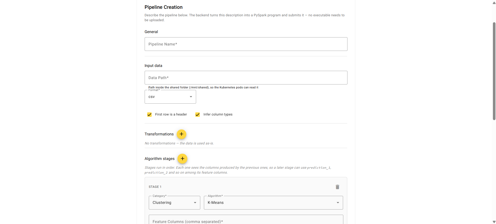
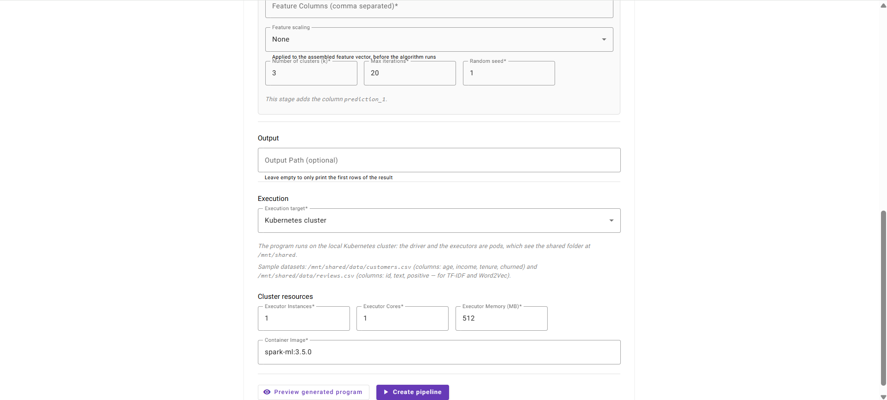
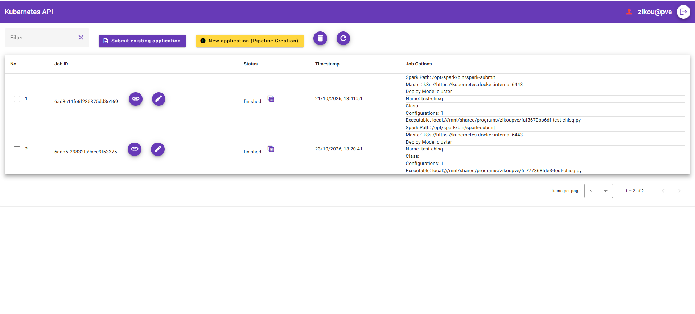
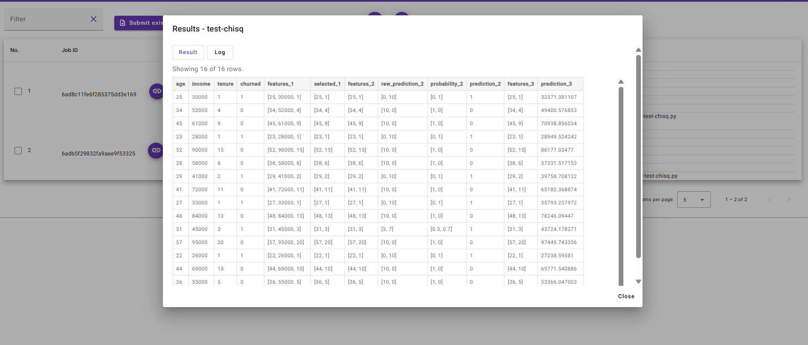
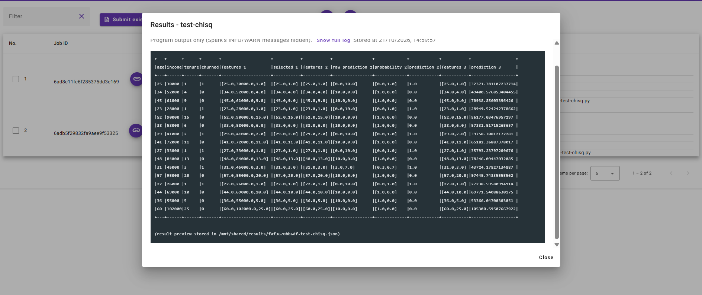

# Design and Implementation of Applications for Apache Spark

*Σχεδιασμός και Υλοποίηση εφαρμογών για το Apache Spark*

A web application for building and running **Apache Spark MLlib pipelines on Kubernetes** without writing any Spark code.
Users describe a pipeline in a form (data, preprocessing, algorithm stages); the backend generates a complete PySpark program, and the executor submits it to Kubernetes with `spark-submit`, where it runs in driver and executor pods. Results are viewable from the UI when the job finishes.

> Diploma thesis, Department of Computer Engineering & Informatics (CEID), University of Patras — Andreas Zikou, 2026.

This project extends [**spark-submit-GUI**](https://github.com/PanagiotisTslk/spark-submit-GUI) by Panagiotis Tsolkas ([thesis, 2024](https://hdl.handle.net/10889/28433)), a GUI for submitting existing Spark programs to Kubernetes. The original commits are preserved in this repository's history.

## Screenshots

**Pipeline Creation** — describe the data, transformations and algorithm stages; the backend generates the PySpark program.

<p>
  
  
</p>

**Jobs** — submitted pipelines run on Kubernetes; finished jobs get a results button.



**Results** — the output of an example pipeline, as a table and as the filtered program log. Every stage adds its own columns (`selected_1`, `prediction_2`, `prediction_3`, …).

<p>
  
  
</p>

## What this thesis adds

The original system removed the terminal from `spark-submit`, but the user still had to write the Spark program themselves. This project removes that step:

- **Pipeline Creation** — a form where the user picks a category → algorithm, sets parameters, data source and output, and chains several stages.
- **JSON → PySpark generator** (`backend/SparkProgramGenerator.py`) — turns the form's JSON spec into a complete, runnable PySpark program, with validation of every field before anything is submitted.
- **Pipelines with any number of stages** — stages are chained in order, each with isolated `features_N` / `prediction_N` columns, so a later stage can use the output of an earlier one (e.g. K-Means → Random Forest).
- **Preprocessing** — `select`, `filter`, `dropna`, `limit`, `StringIndexer`, `OneHotEncoder`, and feature scaling (MinMax / Standard).
- **Safe command building** (`executor/SparkCommandGenerator.py`) — options are validated against the schema stored in MongoDB and `spark-submit` is built as an argument list (no shell).
- **Run on Kubernetes pods** — driver and executors run as pods on a local cluster, sharing programs and data through a `hostPath` volume.
- **Results in the UI** — finished jobs get a results button showing a preview of the output and a filtered job log.
- **Bug fixes in the base system** — the option-validation mechanism was designed but inactive; fixed along with Spark version mismatches, volume mounts and memory-unit handling.

Every change is documented in [`CHANGES.md`](CHANGES.md) (in Greek), entry by entry.

### Supported algorithms

Algorithms are grouped by category; the catalog is being extended with more algorithms per category.

| Category | Algorithms |
|---|---|
| Clustering | K-Means, Bisecting K-Means, Gaussian Mixture |
| Classification | Logistic Regression, Decision Tree, Random Forest |
| Regression | Linear Regression, Decision Tree Regressor |
| Feature Extraction | PCA, Chi-Squared Selector, TF-IDF, Word2Vec |

## Architecture

```
 Browser ──► UI (Angular + nginx) ──► API (Flask) ──► MongoDB
                                         │              ▲
                          generates .py  │              │ polls jobs
                                         ▼              │
                                   shared folder ◄── Executor ──spark-submit──► Kubernetes
                                     (hostPath)                                 driver + executor pods
```

| Service | Tech | Role |
|---|---|---|
| `kubernetes-ui` | Angular 17, nginx | Login, job forms, Pipeline Creation, results |
| `kubernetes-api` | Flask (Python) | REST API, JSON → PySpark generation, job storage |
| `mongo` | MongoDB 7 | Users, jobs, Spark option definitions |
| `kubernetes-executor` | Python, Spark 3.5 | Picks up jobs, builds and runs `spark-submit` |
| `spark-ml` | apache/spark + numpy | Image used by the driver/executor pods |

## Running locally

**Requirements:** Docker Desktop with Kubernetes enabled (tested on Windows).

1. Create a `.env` file in the project root:
   ```env
   DB_USERNAME=<mongo user>
   DB_PASSWORD=<mongo password>
   PROXMOX=<proxmox host, only for the original Proxmox features>
   ```
2. Create the external volumes:
   ```bash
   docker volume create mongo_vol
   docker volume create uploads_vol
   ```
3. Adjust the host paths in `docker-compose.yml` to your machine (shared folder and `~/.kube/config`).
4. Build the Spark pod image, then start the system:
   ```bash
   docker compose --profile images build spark-ml
   docker compose up -d --build
   ```
5. Open http://localhost:8080/#/login

## Status and limitations

- Verified end-to-end on a **local single-node Kubernetes cluster**. Moving to a multi-node cluster is planned.
- The pipelines prove that a Spark program is generated and executed correctly; they do **not** do train/test splitting or model evaluation yet.
- Host paths in `docker-compose.yml` are currently machine-specific.

## Credits

- Original system: **Panagiotis Tsolkas** — [spark-submit-GUI](https://github.com/PanagiotisTslk/spark-submit-GUI)
- Extensions (this thesis): **Andreas Zikou** ([@Andrezik](https://github.com/Andrezik))
